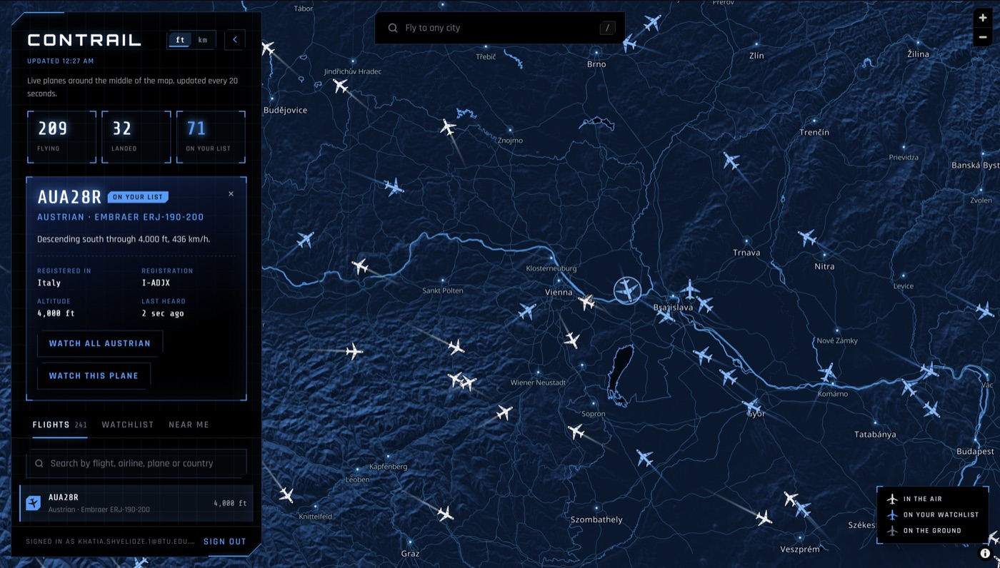
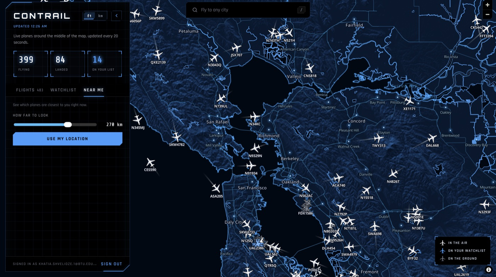
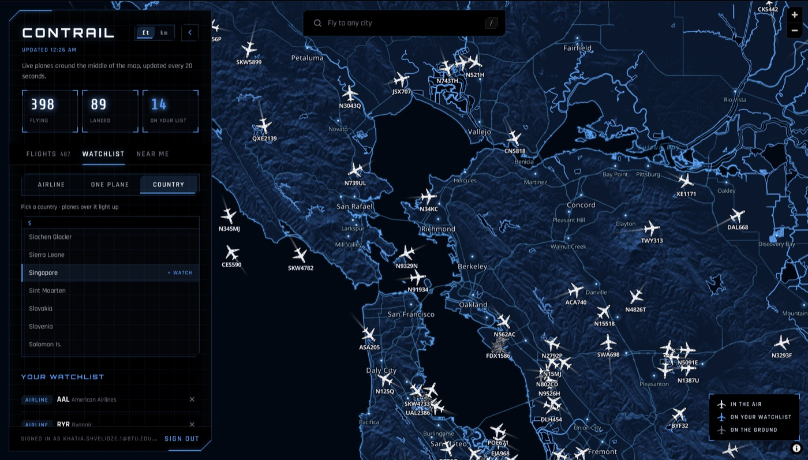
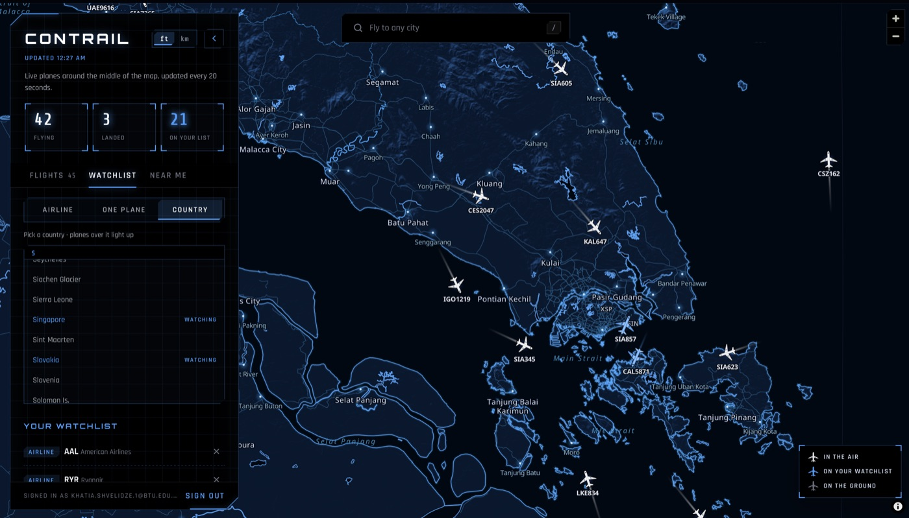

# Contrail

Live planes on a 3D globe. Watch real aircraft move across the map. Click a plane to see the airline, aircraft type, where it's registered and what it's doing right now, e.g. "Cruising east at 37,000 ft, 909 km/h". Done mainly just for me to see them.

## What it does

- Search for a city or just zoom in, and the planes around it show up within seconds.
- NYC is recorded all the time. There you get each plane's recent path, and the map updates as soon as new data comes in.
- Sign in with your email (magic link, no password) to keep a watchlist of airlines, specific planes or whole countries. Watched planes are highlighted in blue. Watching a country loads every plane flying over it, wherever the map is pointed.
- "Near me" lists the closest planes, nearest first.
- The map position is kept in the URL (`#zoom/lat/lon`), so a view can be bookmarked or shared.

## Work in progress

I'm still working on this, mainly on simplifying it and adding more features. Maybe I will add:

- Satellites: live positions of the ISS, Starlink and other satellites from public orbit data, including ground tracks and when they pass overhead.
- Rocket launches: upcoming launches.
- A simpler interface with fewer controls and a cleaner mobile layout.

## WIP

What it currently looks like:

<table>
  <tr>
    <td width="50%"><br><sub>Click a plane: airline, aircraft type, registration and what it's doing now.</sub></td>
    <td width="50%"><br><sub>"Near me" with an adjustable search radius.</sub></td>
  </tr>
  <tr>
    <td width="50%"><br><sub>Watchlist: add airlines, single planes or whole countries.</sub></td>
    <td width="50%"><br><sub>Watching a country highlights every plane over it in blue.</sub></td>
  </tr>
</table>

## How it works

Planes broadcast their position over radio (ADS-B). Volunteers run receivers that pick these signals up and share them through open networks. Contrail reads from two of them, [adsb.fi](https://adsb.fi) and [adsb.lol](https://adsb.lol), and optionally [OpenSky](https://opensky-network.org). Coverage is best where there are lots of receivers, so some planes over remote areas won't appear.

The frontend talking to a Supabase backend:

1. pg_cron calls the `ingest-flights` Edge Function every minute. It asks all sources for planes over New York at once, merges the results (newest position wins, missing fields filled in from the other sources) and writes them to Postgres.
2. `live_aircraft` holds one row per plane currently in the area. `aircraft_positions` keeps history, one point per plane every 3 minutes, and an hourly job deletes anything older than 24 hours.
3. After each run the function sends one Realtime broadcast, and open pages reload the live table in a single request.
4. Outside New York the map calls the `planes-near` Edge Function, which fetches planes around a point live without storing anything. Requests are rounded to a 1° grid so nearby visitors share upstream calls.
5. Row-level security keeps flight data read-only and each watchlist private to its owner.

Only one area is recorded because the whole world is 10,000+ planes a minute, which would blow past the free Supabase database and the data sources' rate limits.

## Stack

- [Supabase](https://supabase.com): Postgres + PostGIS, Edge Functions (Deno), Realtime, Auth, pg_cron, pg_net, Vault
- [MapLibre GL](https://maplibre.org) for the globe, with tiles from [OpenFreeMap](https://openfreemap.org) and terrain from AWS
- [Photon](https://photon.komoot.io) for city search
- [Natural Earth](https://www.naturalearthdata.com) country outlines (world-atlas, via jsDelivr)
- Flight data from adsb.fi, adsb.lol and OpenSky
- pgTAP and Deno tests

## Running it locally

The frontend is static files:

```bash
python3 -m http.server 5173 -d web
```

Then open http://localhost:5173. It uses the Supabase project set at the top of `web/app.js`.

## Setting up your own backend

You need a Supabase project and the Supabase CLI (`brew install supabase/tap/supabase`).

```bash
supabase login
supabase link --project-ref YOUR-PROJECT-REF
supabase db push --remote
```

Create a secret so only your cron job can call the ingest function, and keep a copy in `.env` (gitignored):

```bash
echo "CRON_SECRET=$(openssl rand -hex 24)" > .env
source .env
supabase secrets set CRON_SECRET=$CRON_SECRET
supabase functions deploy ingest-flights planes-near
```

Test it once:

```bash
curl -X POST https://YOUR-PROJECT-REF.supabase.co/functions/v1/ingest-flights \
  -H "x-cron-secret: $CRON_SECRET"
```

Then fill in your project URL and the cron secret in `supabase/setup/schedule.sql` and run it in the SQL editor.

For the frontend:

1. Put your project URL and publishable (anon) key at the top of `web/app.js`, and add the project URL to `connect-src` in the Content Security Policy in `web/index.html`.
2. In the Supabase dashboard, add `http://localhost:5173` under Authentication > URL Configuration > Redirect URLs so sign-in links come back to the app.

Optional: OpenSky can add planes the other networks miss. Create an API client on your opensky-network.org account page, then:

```bash
supabase secrets set OPENSKY_CLIENT_ID=... OPENSKY_CLIENT_SECRET=...
```

The ingest response lists how many planes each source returned, or why it failed.

## Tests

```bash
deno test supabase/functions/

supabase start       # this one needs Docker
supabase test db
```

## Cr.

Flight data from [adsb.fi](https://adsb.fi) and [adsb.lol](https://adsb.lol) (ODbL). Map from [OpenStreetMap](https://www.openstreetmap.org/copyright) contributors, [OpenMapTiles](https://openmaptiles.org), tiles by [OpenFreeMap](https://openfreemap.org), terrain by Mapzen.
